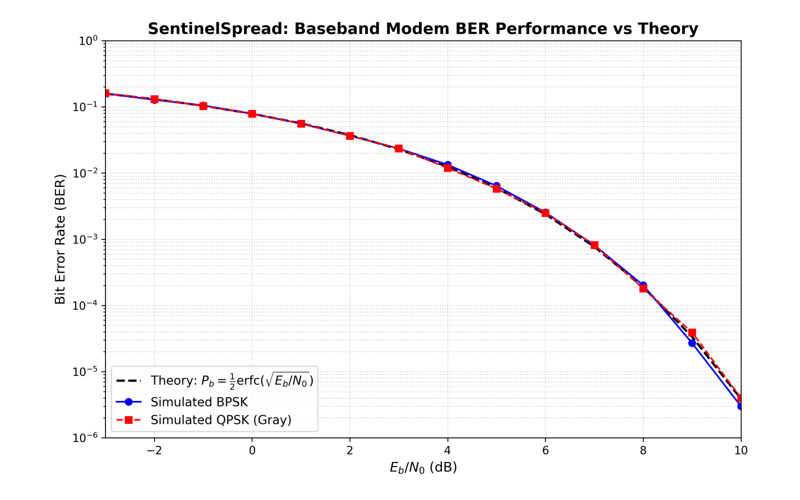
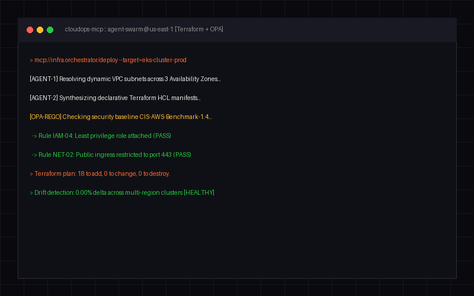
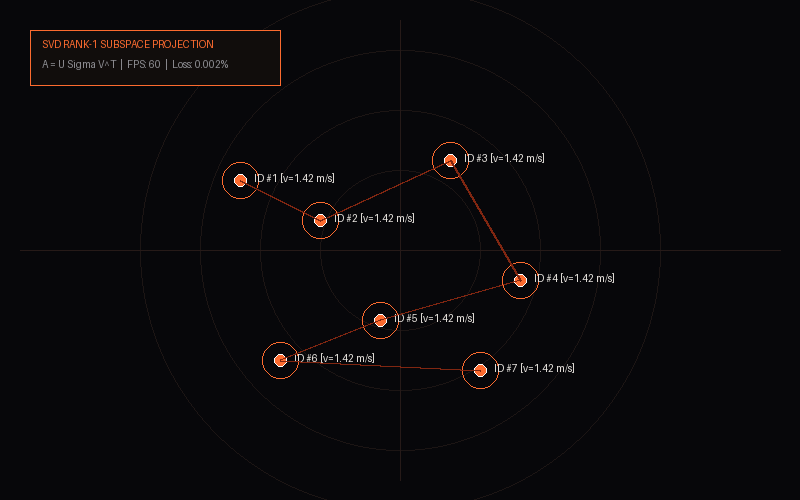
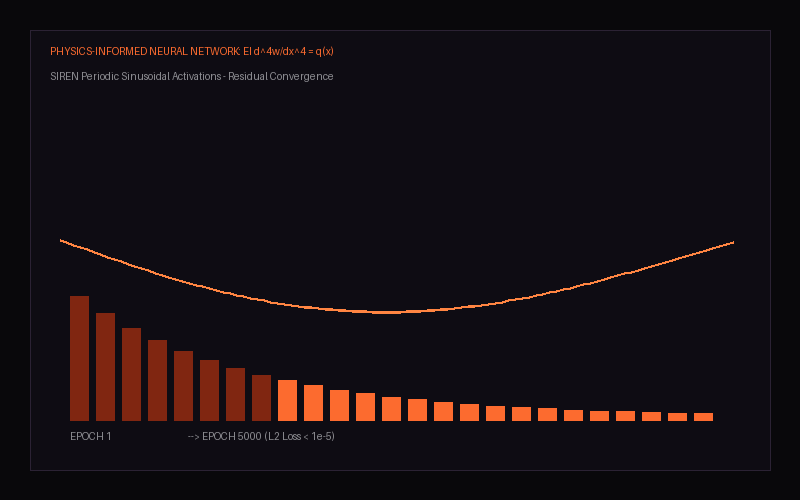
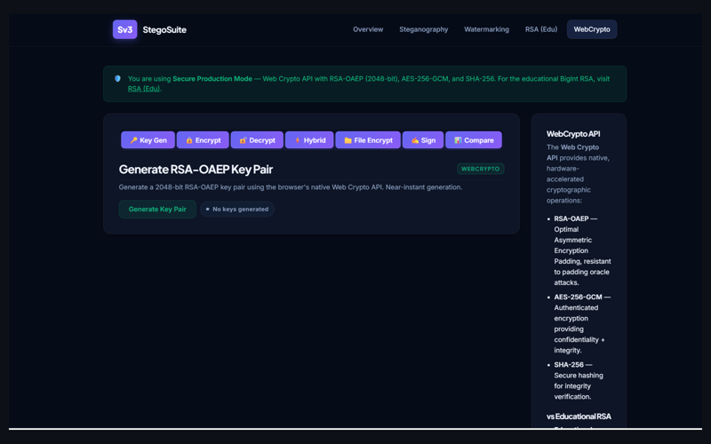

<div align="center">


<a href="https://git.io/typing-svg"></a>

<a href="https://www.linkedin.com/in/saihardhikreddy/"></a>
<a href="mailto:saihardhikreddy@gmail.com"></a>
<a href="https://saihardhikreddy.github.io/issue-scout/"></a>
<a href="https://sentinelspread.vercel.app"></a>

</div>

## 🛰️ About me

I'm a B.Tech **AI & Data Science** student from India who likes problems where math meets real hardware and real users.

```yaml
name:      Sai Hardhik Reddy
focus:     [Software-Defined Radio, Scientific ML, Autonomous agents, Computer vision]
building:  Developer tools: Issue Scout, Gesture Reactions
currently: Spread-spectrum comms, PINNs for structural mechanics, MCP agents
location:  India
open_to:   Internships, research collaborations and open-source work
```

- 📡 **Software-defined radio.** DSSS covert links, Costas-loop carrier recovery, RRC pulse shaping and BER validation against theory.
- 🧠 **Scientific ML.** SIREN physics-informed networks for Euler-Bernoulli beams and ML interatomic potentials for molecular dynamics.
- 👁️ **Computer vision.** SVD rank-1 crowd topography with YOLOv8, ByteTrack and SAHI, plus real-time hand-gesture interfaces.
- ☁️ **Agents and cloud.** Multi-agent Model Context Protocol servers that write Terraform and enforce OPA/Rego policy.

## 🆕 Latest

<table>
  <tr>
    <td width="55%">
      <a href="https://github.com/saihardhikreddy/issue-scout"></a>
    </td>
    <td width="45%">
      <h3>🔭 <a href="https://github.com/saihardhikreddy/issue-scout">Issue Scout</a></h3>
      <p>Finds fresh, unclaimed GitHub issues across <b>all of GitHub</b> and reads each project's AI-contribution policy before you write a line of code.</p>
      <p>Repo-first and issue-first search · batched GraphQL · policy verdicts · comes as a CLI, a web demo and a Claude Code skill.</p>
      <p>
        <a href="https://saihardhikreddy.github.io/issue-scout/"><b>▶ Live demo</b></a> ·
        <a href="https://github.com/saihardhikreddy/issue-scout"><b>Repository</b></a>
      </p>
      
      
      
    </td>
  </tr>
</table>

## 🚀 Featured projects

<table>
  <tr>
    <td width="50%" valign="top">
      <a href="https://github.com/saihardhikreddy/SentinelSpread"></a>
      <h3>📡 <a href="https://github.com/saihardhikreddy/SentinelSpread">SentinelSpread SDR</a></h3>
      DSSS physical-layer engine with Costas carrier sync, Gardner timing recovery and RRC pulse shaping. Simulated BPSK/QPSK BER tracks the theoretical curve.<br><br>
      <code>Python</code> <code>DSP</code> <code>GNU Radio</code> · <a href="https://sentinelspread.vercel.app">live demo</a>
    </td>
    <td width="50%" valign="top">
      <a href="https://github.com/saihardhikreddy/cloudops-os-mcp"></a>
      <h3>☁️ <a href="https://github.com/saihardhikreddy/cloudops-os-mcp">CloudOps OS MCP</a></h3>
      Autonomous multi-agent Model Context Protocol pipeline that writes Terraform, optimizes cost and enforces OPA/Rego compliance with LLM reasoning.<br><br>
      <code>TypeScript</code> <code>MCP</code> <code>Terraform</code> <code>OPA</code>
    </td>
  </tr>
  <tr>
    <td width="50%" valign="top">
      <a href="https://github.com/saihardhikreddy/omni-track"></a>
      <h3>👁️ <a href="https://github.com/saihardhikreddy/omni-track">Omni-Track SVD</a></h3>
      Real-time crowd topography: SVD rank-1 decomposition fused with YOLOv8, ByteTrack and SAHI sliced inference for anomaly detection in dense crowds.<br><br>
      <code>Python</code> <code>OpenCV</code> <code>YOLOv8</code> <code>NumPy</code>
    </td>
    <td width="50%" valign="top">
      <a href="https://github.com/saihardhikreddy/FD-PINN-Beam-Inverse"></a>
      <h3>🧠 <a href="https://github.com/saihardhikreddy/FD-PINN-Beam-Inverse">FD-PINN Beam Inverse</a></h3>
      Frequency-domain PINN with SIREN activations that discovers dynamic stiffness in Euler-Bernoulli beam vibrations, optimized with L-BFGS.<br><br>
      <code>PyTorch</code> <code>Scientific ML</code> <code>PINNs</code>
    </td>
  </tr>
  <tr>
    <td width="50%" valign="top">
      <a href="https://github.com/saihardhikreddy/gesture-reactions"></a>
      <h3>🖐️ <a href="https://github.com/saihardhikreddy/gesture-reactions">Gesture Reactions</a></h3>
      macOS-style video-call reactions for Windows. It tracks 21 hand keypoints with MediaPipe and turns 👍 ✌️ 🫶 into on-screen effects, including in WhatsApp calls.<br><br>
      <code>Python</code> <code>MediaPipe</code> <code>OpenCV</code>
    </td>
    <td width="50%" valign="top">
      <a href="https://github.com/saihardhikreddy/steganography-and-watermarking"></a>
      <h3>🔐 <a href="https://github.com/saihardhikreddy/steganography-and-watermarking">Steganography Suite</a></h3>
      Browser-based suite for LSB image steganography, RSA keypairs, AES-GCM and digital watermarking, built on the Web Crypto API.<br><br>
      <code>JavaScript</code> <code>Web Crypto</code> <code>RSA</code> <code>AES-GCM</code>
    </td>
  </tr>
</table>

<details>
<summary><b>🔍 More projects</b></summary>
<br>

| Project | What it is | Stack |
| --- | --- | --- |
| [🔬 Copper Tensile Deformation](https://github.com/saihardhikreddy/Copper-Tensile-Deformation-Informatics) | LAMMPS + OVITO pipeline for FCC copper tensile failure at 300 K to 900 K, with DXA dislocation tracking | LAMMPS, OVITO, Python |
| [⚛️ LAMMPS-AI](https://github.com/saihardhikreddy/Lammps-AI) | Machine-learning interatomic potentials and GNN surrogates for molecular dynamics | PyTorch, DeepMD |
| [🧳 WanderIndia](https://github.com/saihardhikreddy/WanderIndia) | AI travel planner for Indian road trips with live route scanning | Flask, Groq Llama-3, Geoapify |
| [🎯 Sky Forge Air Defence](https://github.com/saihardhikreddy/Mini-Air-Defence-System-Sky_Forge) | Miniature air-defence system: Arduino, servo tracking and a radar GUI | C++, Arduino, Processing |
| [🚦 Predictive Edge AI Routing](https://github.com/saihardhikreddy/predictive-edge-ai-routing) | Learning, privacy-preserving and self-defending routing for offline Bluetooth mesh networks (team course project) | Kotlin, BLE |
| [🎨 afterlight](https://github.com/saihardhikreddy/afterlight) | Agent design systems, UI skills and web craft patterns | JavaScript |

</details>

## 📊 Research snapshots

<table>
  <tr>
    <td width="33%"><br><sub><b>DSSS spectrum flattening.</b> Chip spreading pushes the signal under the noise floor.</sub></td>
    <td width="33%"><br><sub><b>Copper tensile failure.</b> Stress-strain curves at 300 K, 600 K and 900 K.</sub></td>
    <td width="33%"><br><sub><b>OVITO DXA at 300 K.</b> Shockley partials and stacking faults under strain.</sub></td>
  </tr>
</table>

## 🧰 Tech stack

<p align="center">
  <br>
  <br>
  
</p>

```text
SDR & Telecom    DSSS · BPSK/QPSK · Costas loop · Gardner timing · RRC filtering · GNU Radio
Scientific ML    SIREN PINNs · Euler-Bernoulli PDEs · DeepMD-kit · GNN surrogates · L-BFGS
Vision           YOLOv8 · ByteTrack · SAHI · MediaPipe · SVD rank-1 tracking
Agents & Cloud   Model Context Protocol · Terraform · OPA/Rego · Docker · GitHub Actions
Simulation       LAMMPS · OVITO DXA · SciPy · NumPy
```

## 📈 GitHub stats

<p align="center">
  
  
</p>

## 📫 Let's talk

I'm open to internships, research collaborations and interesting open-source work.
The fastest way to reach me is [email](mailto:saihardhikreddy@gmail.com) or [LinkedIn](https://www.linkedin.com/in/saihardhikreddy/).

<p align="center"></p>
