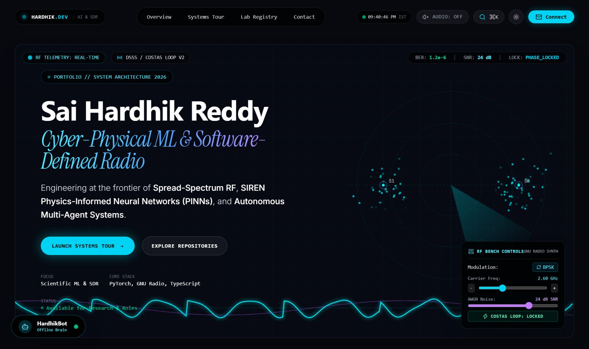
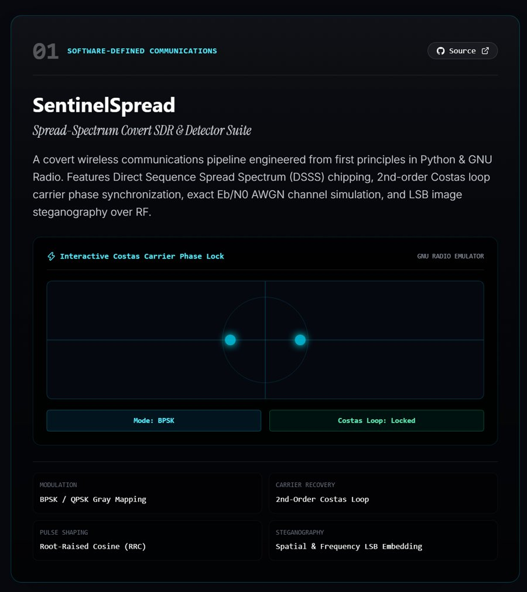
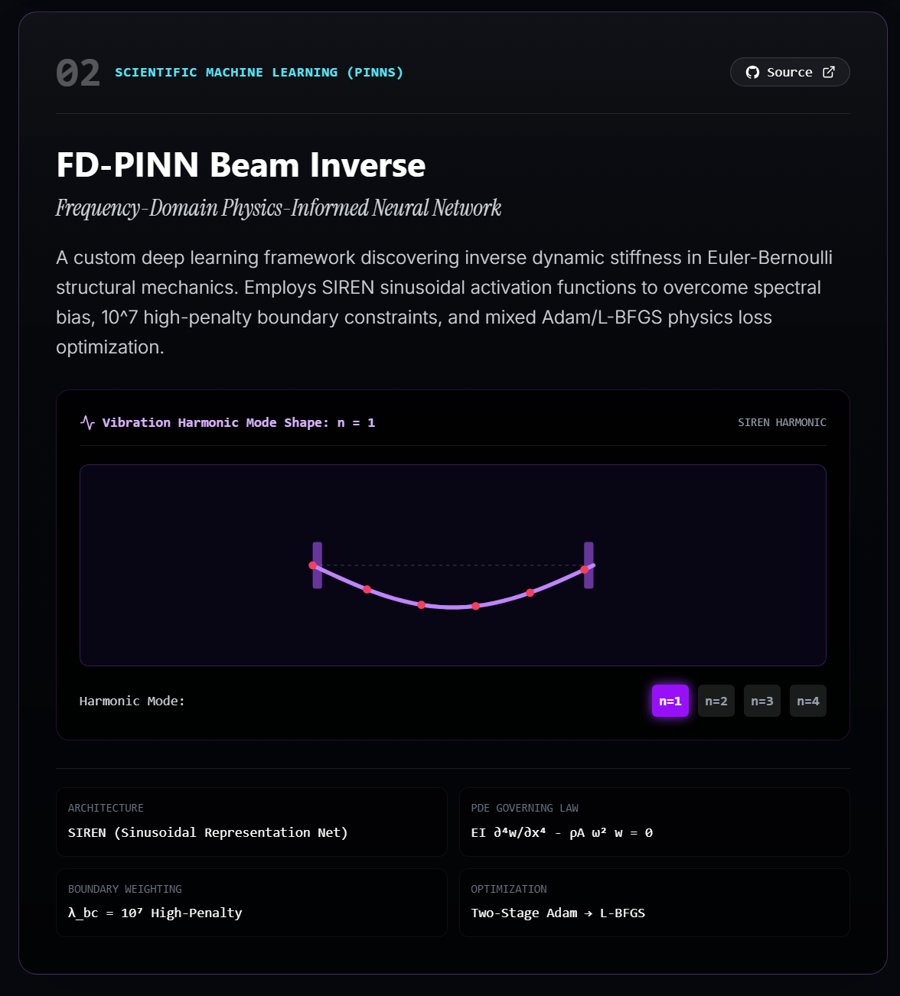
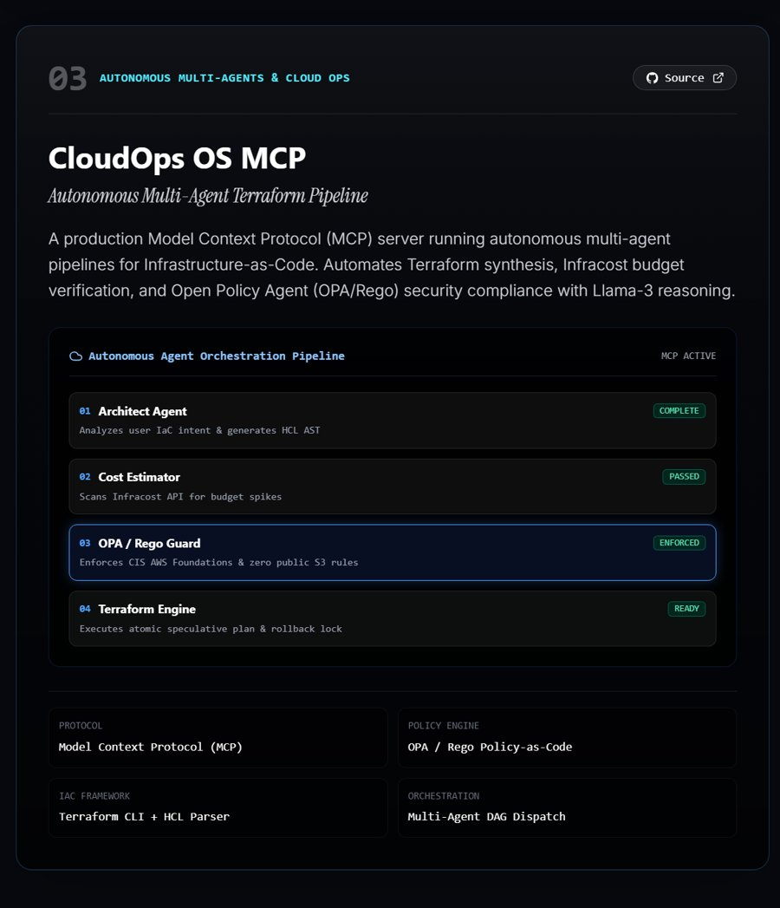
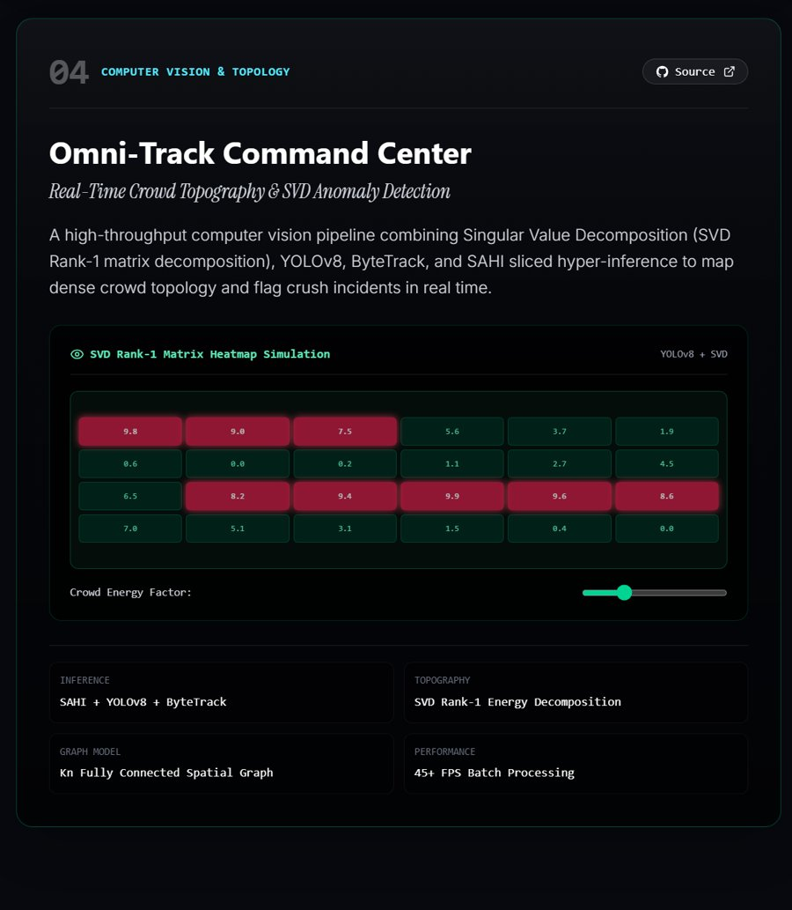
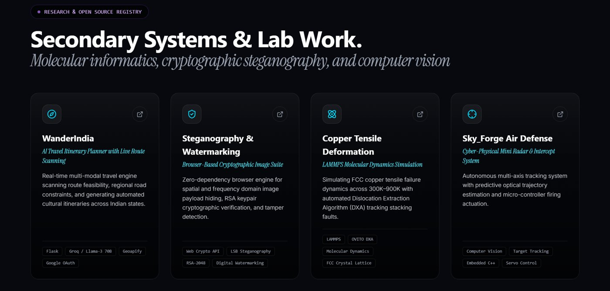
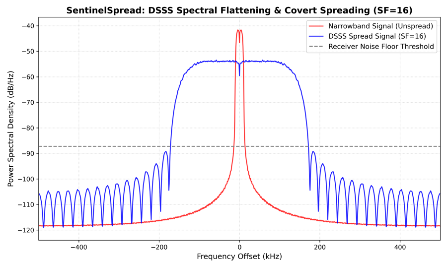
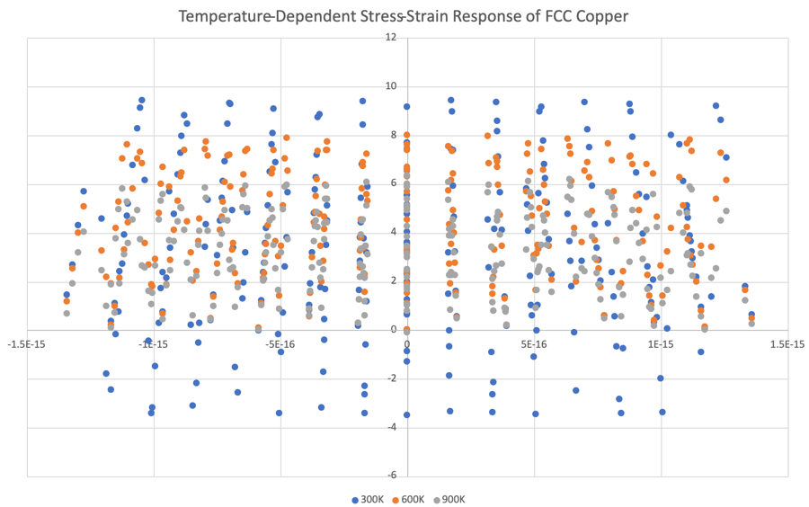
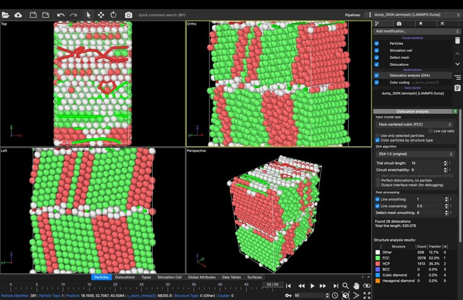

   

<table>
  <tr>
    <td width="33%" align="center">FOCUS <b>Scientific ML &amp; SDR</b></td>
    <td width="34%" align="center">CORE STACK <b>PyTorch · GNU Radio · TypeScript</b></td>
    <td width="33%" align="center">STATUS <b>🟢 Available for research &amp; roles</b></td>
  </tr>
</table>

## 🛰️ About

I'm a B.Tech **AI & Data Science** student from India, engineering at the frontier of
**spread-spectrum RF**, **SIREN physics-informed neural networks** and **autonomous multi-agent systems**.
I build things from first principles, then put an interactive simulator next to them so anyone can poke at the physics.

  
   My portfolio: live RF telemetry, a GNU Radio bench you can tune, and a radar of my systems.

## 🧪 Every node is an experiment

These are my four flagship systems, in the order of my portfolio's systems tour. Each card is a screenshot of its live simulator.

<table>
  <tr>
    <td width="50%" valign="top">
      
      <h3>01 · <a href="https://github.com/saihardhikreddy/SentinelSpread">SentinelSpread</a></h3>
      <i>Spread-spectrum covert SDR &amp; detector suite</i> 
      DSSS chipping, 2nd-order Costas carrier recovery, RRC pulse shaping, exact Eb/N0 AWGN simulation and LSB steganography over RF.  
      <code>Python</code> <code>GNU Radio</code> <code>DSP</code> · <a href="https://sentinelspread.vercel.app"><b>live demo</b></a>
    </td>
    <td width="50%" valign="top">
      
      <h3>02 · <a href="https://github.com/saihardhikreddy/FD-PINN-Beam-Inverse">FD-PINN Beam Inverse</a></h3>
      <i>Frequency-domain physics-informed neural network</i> 
      Discovers inverse dynamic stiffness in Euler-Bernoulli beams with SIREN activations, 107 boundary penalties and two-stage Adam → L-BFGS.  
      <code>PyTorch</code> <code>PINNs</code> <code>Scientific ML</code>
    </td>
  </tr>
  <tr>
    <td width="50%" valign="top">
      
      <h3>03 · <a href="https://github.com/saihardhikreddy/cloudops-os-mcp">CloudOps OS MCP</a></h3>
      <i>Autonomous multi-agent Terraform pipeline</i> 
      A Model Context Protocol server where architect, cost, OPA/Rego and Terraform agents plan infrastructure, check budgets with Infracost and enforce CIS rules.  
      <code>TypeScript</code> <code>MCP</code> <code>Terraform</code> <code>OPA</code>
    </td>
    <td width="50%" valign="top">
      
      <h3>04 · <a href="https://github.com/saihardhikreddy/omni-track">Omni-Track Command Center</a></h3>
      <i>Real-time crowd topography &amp; SVD anomaly detection</i> 
      SVD rank-1 energy decomposition with YOLOv8, ByteTrack and SAHI sliced inference to map dense crowds and flag crush risk in real time.  
      <code>Python</code> <code>YOLOv8</code> <code>OpenCV</code> <code>NumPy</code>
    </td>
  </tr>
</table>

## 🛠️ Tools I've shipped

<table>
  <tr>
    <td width="55%">
      
    </td>
    <td width="45%" valign="top">
      <h3>🔭 <a href="https://github.com/saihardhikreddy/issue-scout">Issue Scout</a></h3>
      Searches all of GitHub for fresh, unclaimed issues and reads each project's AI-contribution policy before you write a line of code.  
      <code>Python</code> <code>GraphQL</code> · CLI, web demo and Claude Code skill 
      <a href="https://saihardhikreddy.github.io/issue-scout/"><b>▶ Try the live demo</b></a>
    </td>
  </tr>
  <tr>
    <td width="55%">
      
    </td>
    <td width="45%" valign="top">
      <h3>🖐️ <a href="https://github.com/saihardhikreddy/gesture-reactions">Gesture Reactions</a></h3>
      macOS-style video-call reactions for Windows. MediaPipe tracks 21 points per hand and turns 👍 ✌️ 🫶 into on-screen effects, including in WhatsApp calls.  
      <code>Python</code> <code>MediaPipe</code> <code>OpenCV</code>
    </td>
  </tr>
</table>

## 🔬 Secondary systems & lab work

| Project | What it is | Stack |
| --- | --- | --- |
| [🧳 WanderIndia](https://github.com/saihardhikreddy/WanderIndia) | AI travel planner that scans route feasibility and builds itineraries across Indian states | Flask, Groq Llama-3 70B, Geoapify, Google OAuth |
| [🔐 Steganography & Watermarking](https://github.com/saihardhikreddy/steganography-and-watermarking) | Zero-dependency browser suite for spatial/frequency payload hiding, RSA-2048 verification and tamper detection | Web Crypto API, LSB, RSA-2048 |
| [⚛️ Copper Tensile Deformation](https://github.com/saihardhikreddy/Copper-Tensile-Deformation-Informatics) | FCC copper tensile failure from 300 K to 900 K, with automated DXA tracking of stacking faults | LAMMPS, OVITO DXA |
| [🎯 Sky_Forge Air Defense](https://github.com/saihardhikreddy/Mini-Air-Defence-System-Sky_Forge) | Mini radar and intercept system with predictive trajectory estimation and servo actuation | Embedded C++, computer vision |
| [🧬 LAMMPS-AI](https://github.com/saihardhikreddy/Lammps-AI) | Machine-learning interatomic potentials and GNN surrogates for molecular dynamics | PyTorch, DeepMD |
| [🚦 Predictive Edge AI Routing](https://github.com/saihardhikreddy/predictive-edge-ai-routing) | Learning, privacy-preserving and self-defending routing for offline Bluetooth mesh networks (team project) | Kotlin, BLE |

<b>📊 Research snapshots</b>

 
<table>
  <tr>
    <td width="33%"> <b>DSSS spectrum flattening.</b> Chip spreading pushes the signal under the noise floor.</td>
    <td width="33%"> <b>Copper tensile response</b> at 300 K, 600 K and 900 K.</td>
    <td width="33%"> <b>OVITO DXA at 300 K.</b> Shockley partials and stacking faults under strain.</td>
  </tr>
</table>

## 🧰 Engineering domain matrix

   
  

| Domain | Toolchain |
| --- | --- |
| **Languages** | Python · C++ · TypeScript · JavaScript · SQL · MATLAB · Bash |
| **ML & PINNs** | PyTorch · TensorFlow · SIREN PINNs · YOLOv8 · SAHI · Scikit-Learn · OpenCV |
| **SDR & telecom** | GNU Radio · DSSS · Costas loop · BPSK/QPSK · RRC pulse shaping |
| **CloudOps** | Terraform · Docker · OPA/Rego · Model Context Protocol · GitHub Actions |
| **Simulation** | LAMMPS molecular dynamics · OVITO DXA · SciPy signal & linear algebra |

## 📈 Telemetry

  
  

## 📡 Connect

I'm available for research collaborations and roles. Have a project in mind? Reach me by
[email](mailto:saihardhikreddy@gmail.com) or on [LinkedIn](https://www.linkedin.com/in/saihardhikreddy/).

