<div align="center">


<a href="https://git.io/typing-svg"></a>

<p><a href="https://www.linkedin.com/in/saihardhikreddy/"></a> <a href="mailto:saihardhikreddy@gmail.com"></a> <a href="https://sentinelspread.vercel.app"></a> <a href="https://saihardhikreddy.github.io/issue-scout/"></a></p>

</div>

## ● The philosophy

> I believe great software is born at the intersection of engineering precision and design intuition.

I'm a B.Tech **AI & Data Science** student in Hyderabad, India. I build systems from first principles: spread-spectrum radios,
physics-informed neural networks, autonomous agents and real-time computer vision.

```yaml
name:      Sai Hardhik Reddy
role:      Systems and ML engineer
focus:     [Software-Defined Radio, Scientific ML, Autonomous agents, Computer vision]
location:  Hyderabad, India
status:    Open to opportunities
```

<p align="center">
  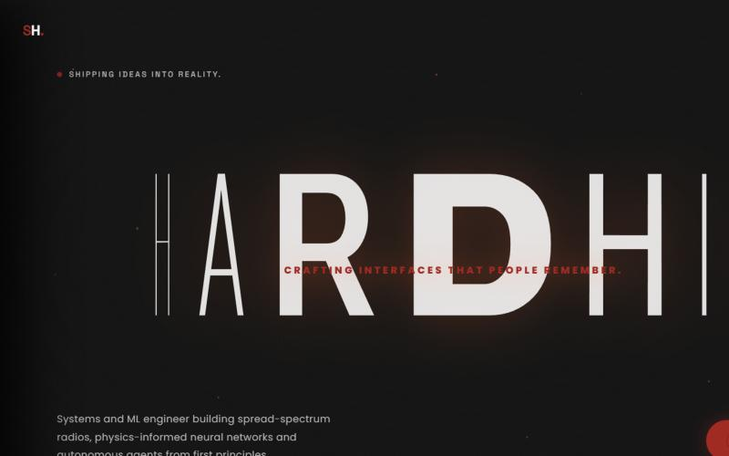
  <br><sub>My portfolio, in the same red and black.</sub>
</p>

## ● Selected projects

<table>
  <tr>
    <td width="50%" valign="top">
      <a href="https://github.com/saihardhikreddy/SentinelSpread">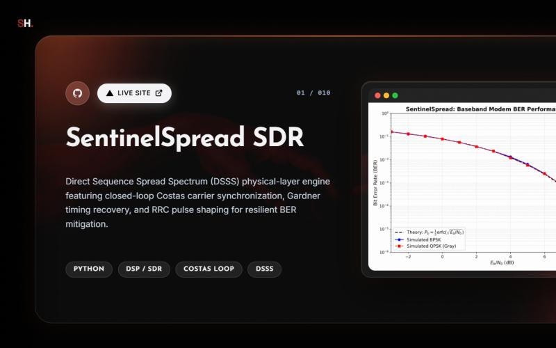</a>
      <h3>01 · <a href="https://github.com/saihardhikreddy/SentinelSpread">SentinelSpread SDR</a></h3>
      DSSS physical-layer engine with closed-loop Costas carrier sync, Gardner timing recovery and RRC pulse shaping. Simulated BER tracks theory.<br><br>
      <code>PYTHON</code> <code>DSP / SDR</code> <code>COSTAS LOOP</code> · <a href="https://sentinelspread.vercel.app"><b>live site ↗</b></a>
    </td>
    <td width="50%" valign="top">
      <a href="https://github.com/saihardhikreddy/cloudops-os-mcp">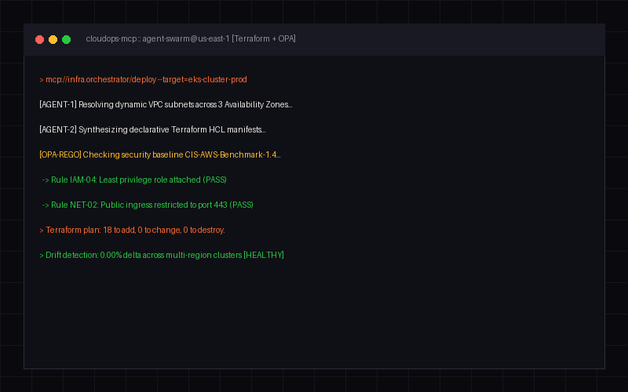</a>
      <h3>02 · <a href="https://github.com/saihardhikreddy/cloudops-os-mcp">CloudOps OS MCP</a></h3>
      Autonomous multi-agent engine on the Model Context Protocol that synthesizes Terraform and enforces OPA/Rego compliance.<br><br>
      <code>TYPESCRIPT</code> <code>MCP</code> <code>TERRAFORM</code> <code>OPA REGO</code>
    </td>
  </tr>
  <tr>
    <td width="50%" valign="top">
      <a href="https://github.com/saihardhikreddy/omni-track">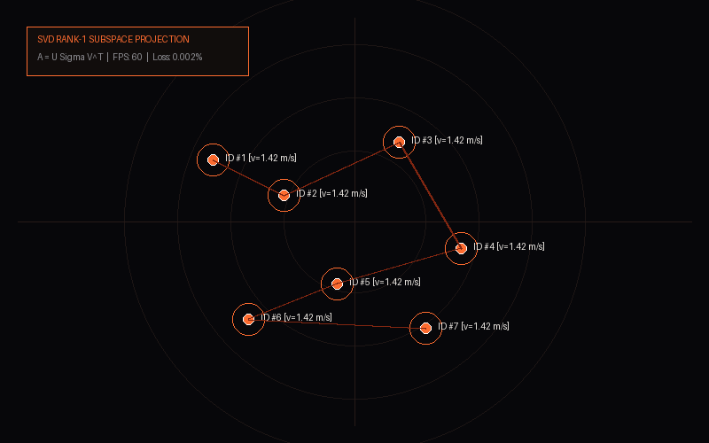</a>
      <h3>03 · <a href="https://github.com/saihardhikreddy/omni-track">Omni-Track SVD</a></h3>
      Real-time crowd topography: SVD rank-1 decomposition fused with YOLOv8, ByteTrack and SAHI sliced inference to flag anomalies.<br><br>
      <code>PYTHON</code> <code>YOLOV8 + BYTETRACK</code> <code>OPENCV</code>
    </td>
    <td width="50%" valign="top">
      <a href="https://github.com/saihardhikreddy/FD-PINN-Beam-Inverse">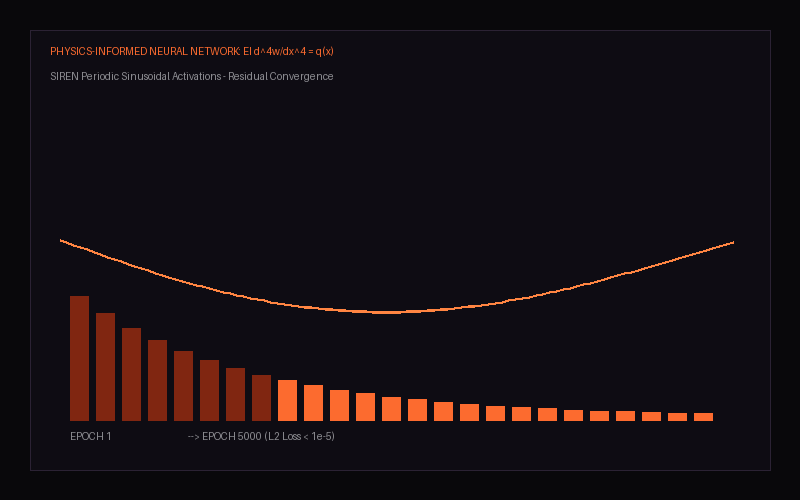</a>
      <h3>04 · <a href="https://github.com/saihardhikreddy/FD-PINN-Beam-Inverse">FD-PINN Beam Mechanics</a></h3>
      Scientific ML that enforces 4th-order Euler-Bernoulli constraints with SIREN networks to discover dynamic stiffness.<br><br>
      <code>PYTORCH</code> <code>PINNS</code> <code>SIREN</code>
    </td>
  </tr>
  <tr>
    <td width="50%" valign="top">
      <a href="https://github.com/saihardhikreddy/issue-scout">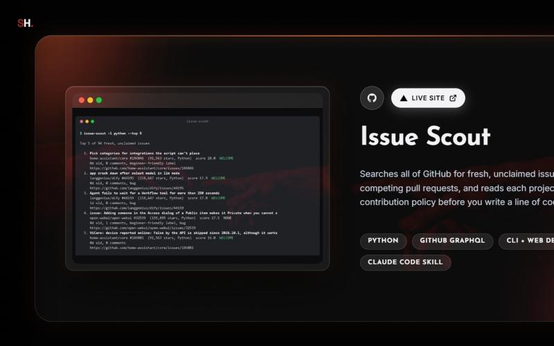</a>
      <h3>05 · <a href="https://github.com/saihardhikreddy/issue-scout">Issue Scout</a></h3>
      Searches all of GitHub for fresh, unclaimed issues and reads each project's AI-contribution policy before you write a line of code.<br><br>
      <code>PYTHON</code> <code>GITHUB GRAPHQL</code> <code>CLAUDE CODE SKILL</code> · <a href="https://saihardhikreddy.github.io/issue-scout/"><b>live site ↗</b></a>
    </td>
    <td width="50%" valign="top">
      <a href="https://github.com/saihardhikreddy/gesture-reactions"></a>
      <h3>06 · <a href="https://github.com/saihardhikreddy/gesture-reactions">Gesture Reactions</a></h3>
      macOS Sonoma-style video-call reactions for Windows. MediaPipe tracks 21 landmarks per hand and turns gestures into effects, even in WhatsApp calls.<br><br>
      <code>PYTHON</code> <code>MEDIAPIPE</code> <code>VIRTUAL CAMERA</code>
    </td>
  </tr>
  <tr>
    <td width="50%" valign="top">
      <a href="https://github.com/saihardhikreddy/Copper-Tensile-Deformation-Informatics"></a>
      <h3>07 · <a href="https://github.com/saihardhikreddy/Copper-Tensile-Deformation-Informatics">Copper MD Tensile Dynamics</a></h3>
      FCC copper tensile failure from 300 K to 900 K under the Mishin EAM potential, with OVITO DXA dislocation analysis.<br><br>
      <code>LAMMPS</code> <code>OVITO DXA</code> <code>PYTHON</code>
    </td>
    <td width="50%" valign="top">
      <a href="https://github.com/saihardhikreddy/steganography-and-watermarking">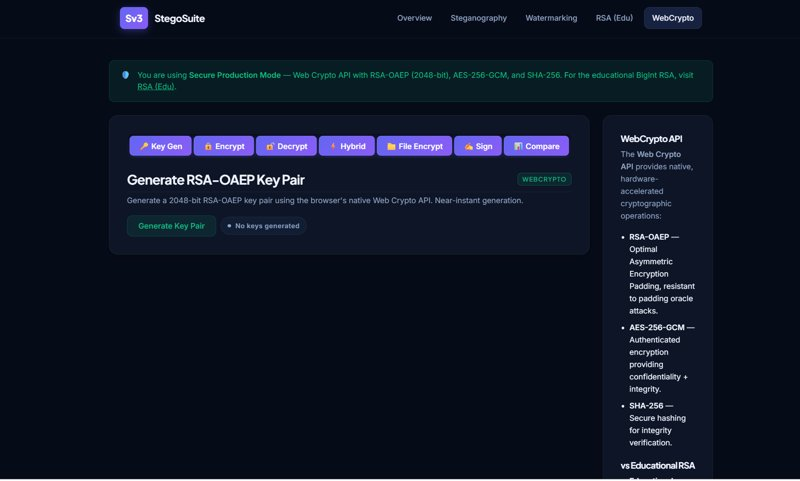</a>
      <h3>08 · <a href="https://github.com/saihardhikreddy/steganography-and-watermarking">Steganography Suite</a></h3>
      Browser suite for spatial and frequency-domain steganography, AES-GCM-256 encryption, RSA-2048 signatures and watermarking.<br><br>
      <code>WEB CRYPTO API</code> <code>RSA-2048</code> <code>AES-GCM-256</code>
    </td>
  </tr>
  <tr>
    <td width="50%" valign="top">
      <a href="https://github.com/saihardhikreddy/Mini-Air-Defence-System-Sky_Forge">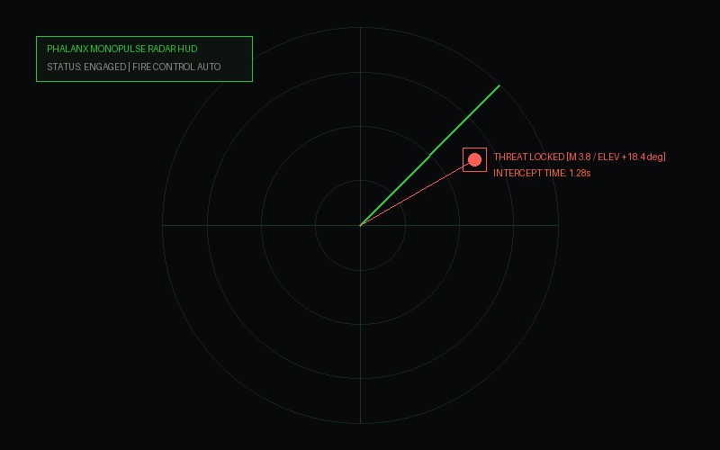</a>
      <h3>09 · <a href="https://github.com/saihardhikreddy/Mini-Air-Defence-System-Sky_Forge">Sky Forge Air Defence</a></h3>
      Drone-defence prototype: an Arduino sense-think-act loop sweeps, validates targets by distance and aligns a servo turret.<br><br>
      <code>ARDUINO UNO</code> <code>C++</code> <code>PROCESSING GUI</code>
    </td>
    <td width="50%" valign="top">
      <a href="https://github.com/saihardhikreddy/Lammps-AI">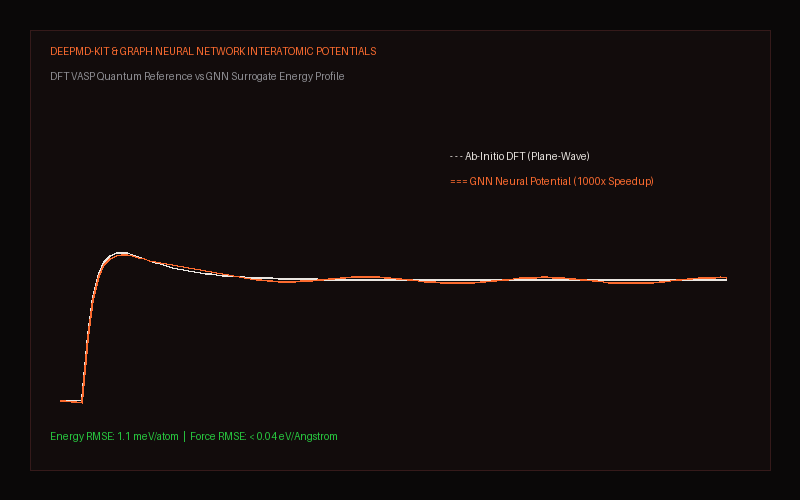</a>
      <h3>10 · <a href="https://github.com/saihardhikreddy/Lammps-AI">LAMMPS-AI Potentials</a></h3>
      Bridges LAMMPS molecular dynamics with ML interatomic potentials, active-learning sampling and surrogate models.<br><br>
      <code>DEEPMD-KIT</code> <code>LAMMPS</code> <code>PYTORCH</code>
    </td>
  </tr>
</table>

<details>
<summary><b>More: Predictive Edge AI Routing, WanderIndia, research plots</b></summary>
<br>

| Project | What it is |
| --- | --- |
| [🚦 Predictive Edge AI Routing](https://github.com/saihardhikreddy/predictive-edge-ai-routing) | Learned, self-defending routing for offline Bluetooth meshes with gossip FedAvg and a CUSUM intrusion detector (team project) |
| [🧳 WanderIndia](https://github.com/saihardhikreddy/WanderIndia) | AI road-trip planner for India with live route scanning (Flask, Groq Llama-3, Geoapify) |

<table>
  <tr>
    <td width="50%"><br><sub><b>DSSS spectrum flattening.</b> Chip spreading pushes the signal under the noise floor.</sub></td>
    <td width="50%"><br><sub><b>Copper tensile response</b> at 300 K, 600 K and 900 K.</sub></td>
  </tr>
</table>
</details>

## ● Technical arsenal

<table>
  <tr>
    <td width="55%">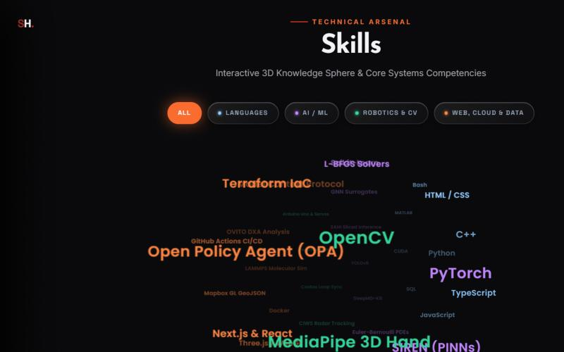</td>
    <td width="45%" valign="top">

**Languages** · Python, C++, TypeScript, JavaScript, SQL, MATLAB, Bash

**AI / ML** · PyTorch, SIREN PINNs, DeepMD-kit, YOLOv8, SAHI, Scikit-Learn

**Robotics & CV** · OpenCV, MediaPipe, ByteTrack, Arduino, Costas loop sync

**Web, cloud & data** · MCP, Terraform, OPA, Docker, GitHub Actions, LAMMPS, OVITO

</td>
  </tr>
</table>

<p align="center">
  
</p>

## ● Where I've been

<p align="center">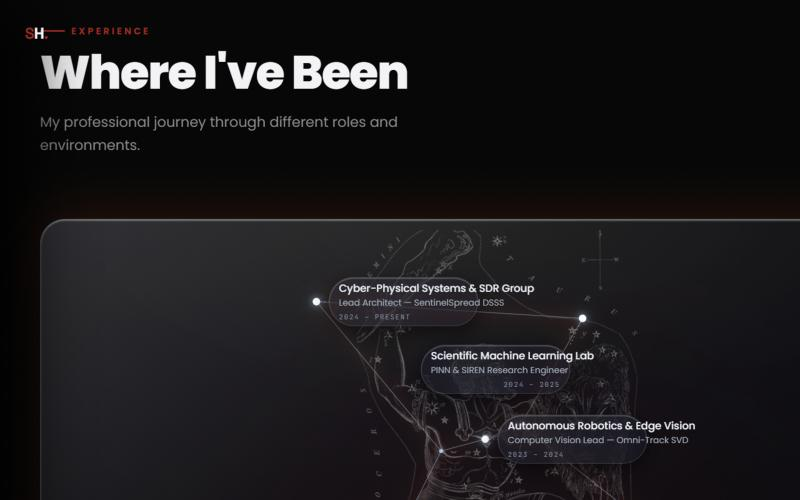</p>

## ● Telemetry

<p align="center">
  
  
</p>

## ● Let's create something extraordinary

Have a project in mind or want to collaborate? Reach me by [email](mailto:saihardhikreddy@gmail.com) or on [LinkedIn](https://www.linkedin.com/in/saihardhikreddy/).

<p align="center"></p>
