

   

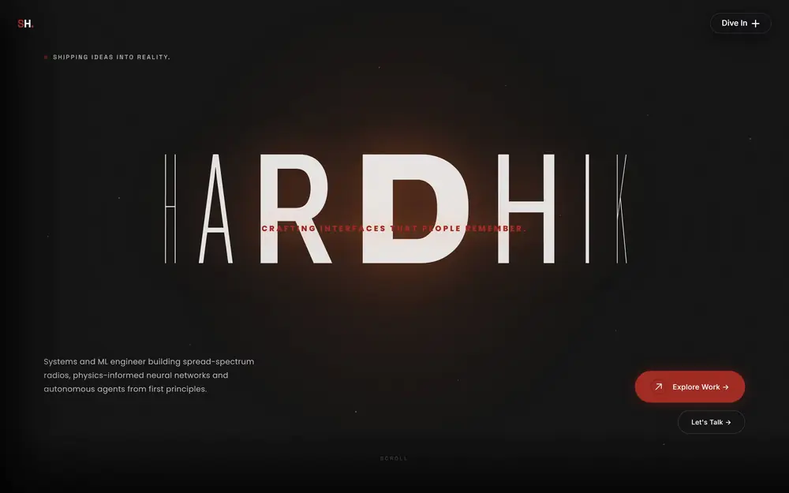

A scroll through my portfolio: the hero, the philosophy, selected projects, skills and experience.

 

<table>
  <tr>
    <td width="50%" valign="top">

### ● About

I'm a B.Tech **AI & Data Science** student in Hyderabad, India.
I build systems from first principles, then make them visible:
spread-spectrum radios, physics-informed neural networks,
autonomous agents and real-time computer vision.

> *Great software is born at the intersection of engineering precision and design intuition.*

</td>
    <td width="50%" valign="top">

### ● At a glance

| | |
| --- | --- |
| 📡 **Focus** | SDR · Scientific ML · Agents · Vision |
| 🧪 **Shipped** | 13 public repositories |
| 🌐 **Live demos** | [SentinelSpread](https://sentinelspread.vercel.app) · [Issue Scout](https://saihardhikreddy.github.io/issue-scout/) |
| 📍 **Based in** | Hyderabad, India |
| 🟢 **Status** | Open to opportunities |

</td>
  </tr>
</table>

## ● Selected projects

<a href="https://github.com/saihardhikreddy/SentinelSpread">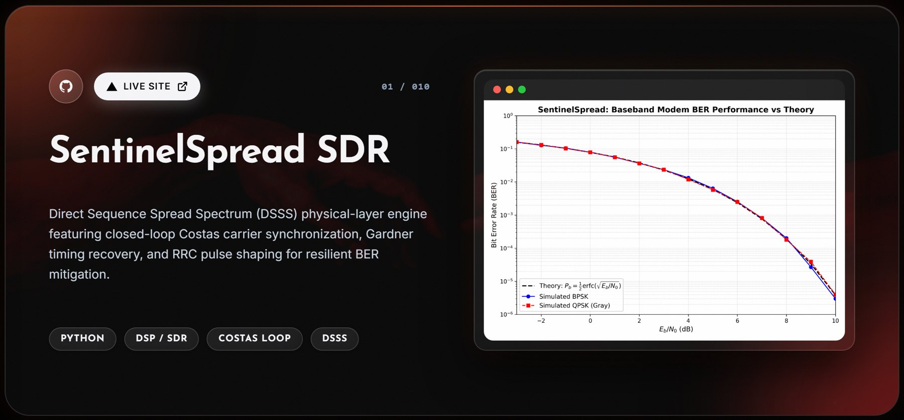</a>

<a href="https://github.com/saihardhikreddy/SentinelSpread"><b>Code</b></a> · <a href="https://sentinelspread.vercel.app"><b>Live site ↗</b></a>

<table>
  <tr>
    <td width="50%"><a href="https://github.com/saihardhikreddy/cloudops-os-mcp">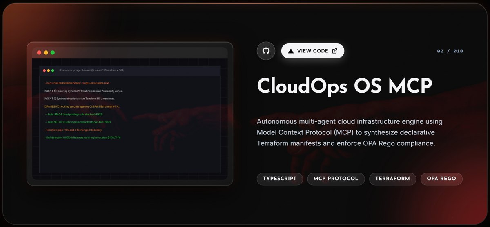</a></td>
    <td width="50%"><a href="https://github.com/saihardhikreddy/omni-track">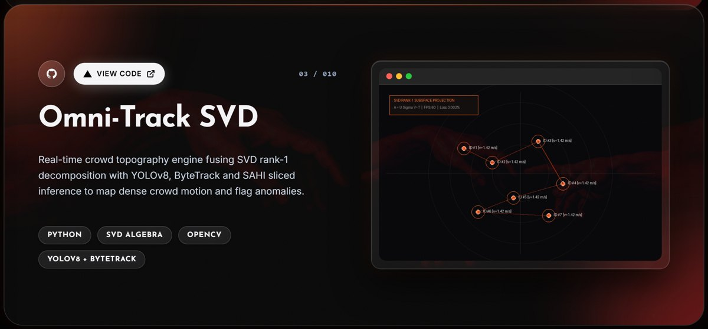</a></td>
  </tr>
  <tr>
    <td width="50%"><a href="https://github.com/saihardhikreddy/FD-PINN-Beam-Inverse">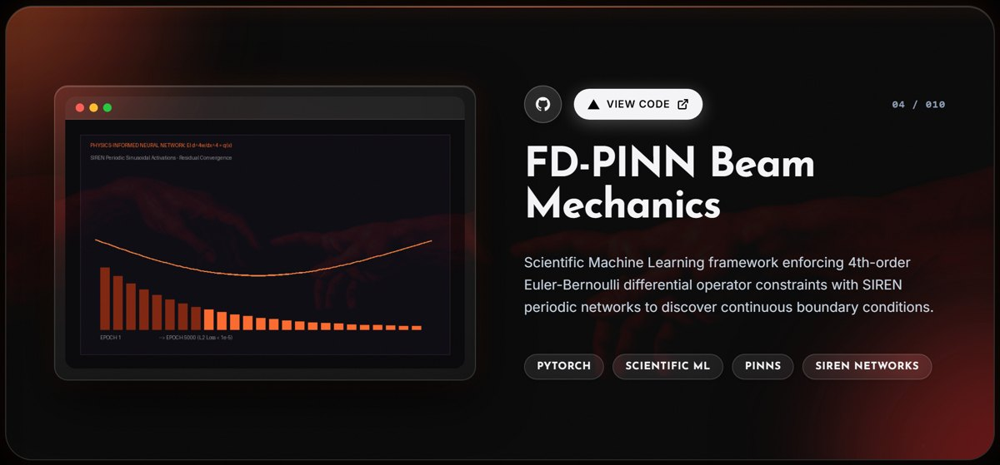</a></td>
    <td width="50%"><a href="https://github.com/saihardhikreddy/issue-scout">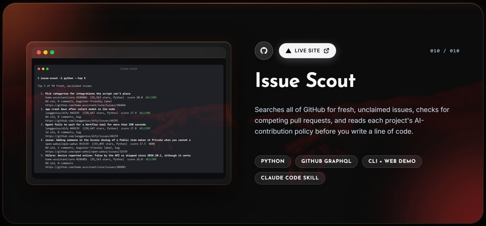</a></td>
  </tr>
  <tr>
    <td width="50%"><a href="https://github.com/saihardhikreddy/gesture-reactions">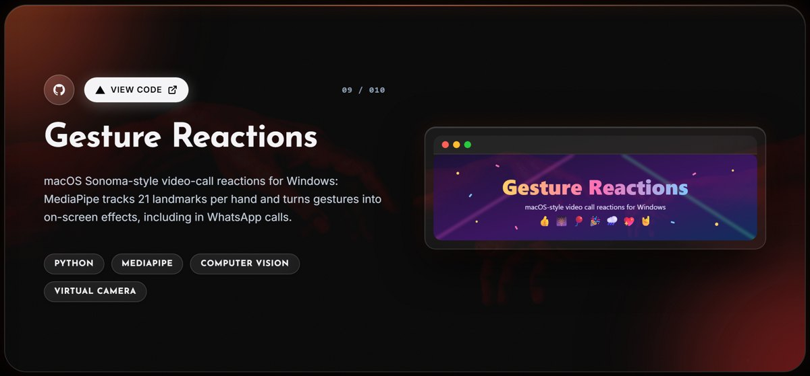</a></td>
    <td width="50%"><a href="https://github.com/saihardhikreddy/Copper-Tensile-Deformation-Informatics">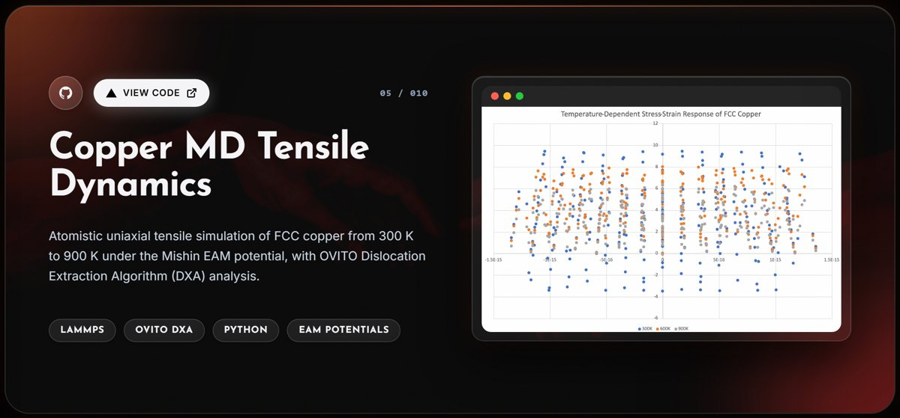</a></td>
  </tr>
  <tr>
    <td width="50%"><a href="https://github.com/saihardhikreddy/Mini-Air-Defence-System-Sky_Forge">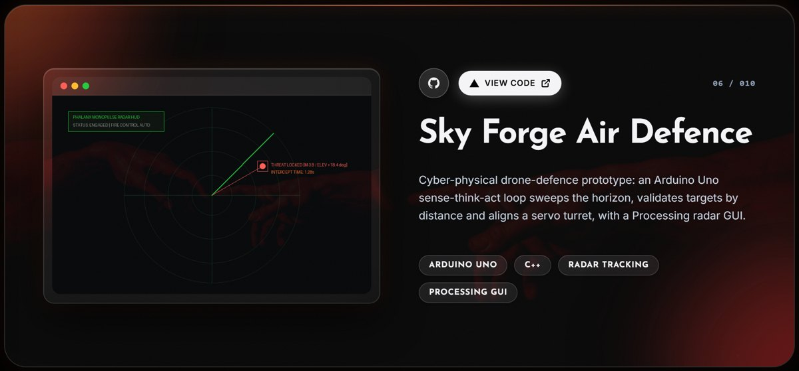</a></td>
    <td width="50%"><a href="https://github.com/saihardhikreddy/Lammps-AI">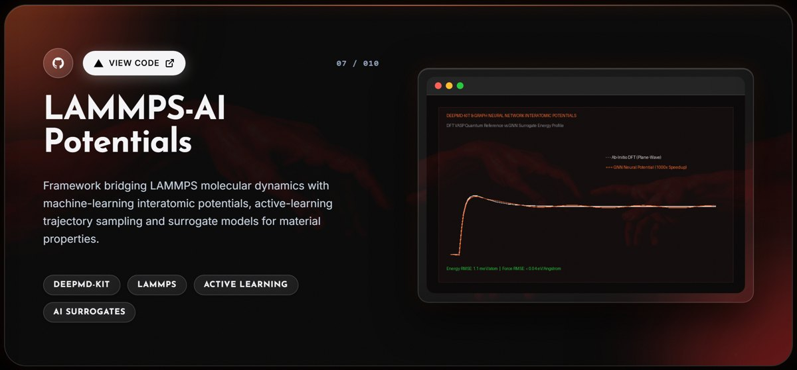</a></td>
  </tr>
  <tr>
    <td width="50%"><a href="https://github.com/saihardhikreddy/steganography-and-watermarking">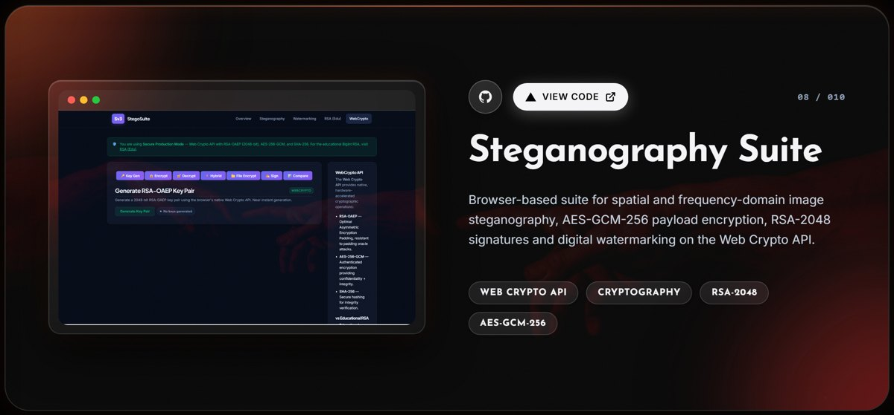</a></td>
    <td width="50%" valign="middle">

**Also building**

- [🚦 Predictive Edge AI Routing](https://github.com/saihardhikreddy/predictive-edge-ai-routing): self-defending routing for offline Bluetooth meshes (team project)
- [🧳 WanderIndia](https://github.com/saihardhikreddy/WanderIndia): AI road-trip planner for India

Every card links to its repository.

</td>
  </tr>
</table>

## ● Technical arsenal

<table>
  <tr>
    <td width="50%">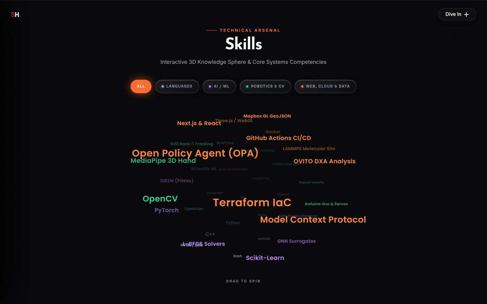</td>
    <td width="50%">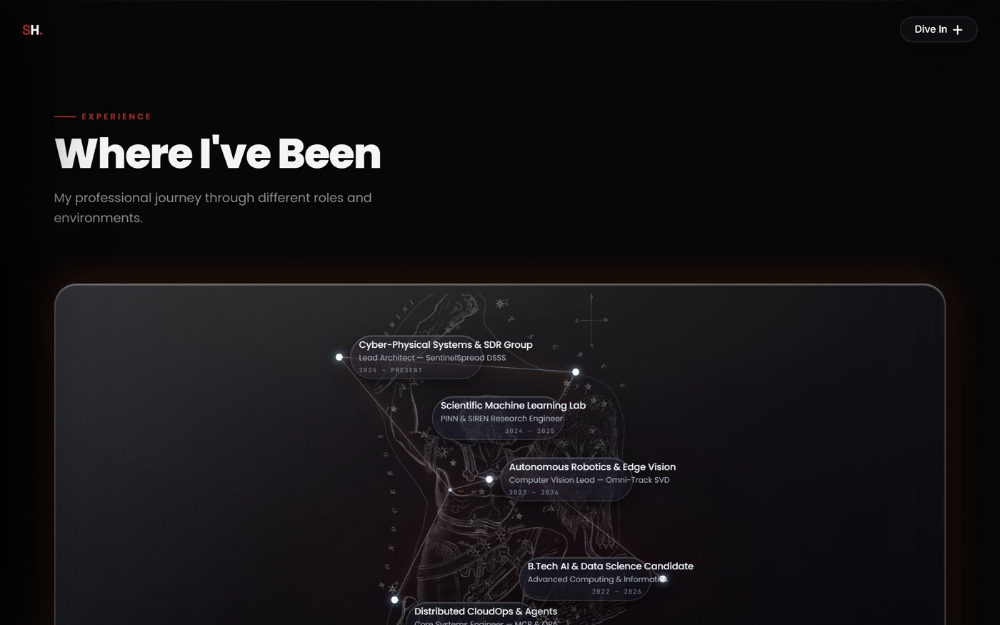</td>
  </tr>
  <tr>
    <td align="center">The 3D skills sphere on my portfolio</td>
    <td align="center">Where I've been, drawn as a constellation</td>
  </tr>
</table>

| Domain | Toolchain |
| --- | --- |
| **Languages** | Python · C++ · TypeScript · JavaScript · SQL · MATLAB · Bash |
| **AI / ML** | PyTorch · SIREN PINNs · DeepMD-kit · YOLOv8 · SAHI · Scikit-Learn |
| **Robotics & CV** | OpenCV · MediaPipe · ByteTrack · Arduino · Costas loop sync |
| **Cloud & simulation** | MCP · Terraform · OPA/Rego · Docker · GitHub Actions · LAMMPS · OVITO |

  

## ● Telemetry

  
  

## ● Let's create something extraordinary

Have a project in mind or want to collaborate? Reach me by [email](mailto:saihardhikreddy@gmail.com) or on [LinkedIn](https://www.linkedin.com/in/saihardhikreddy/).

